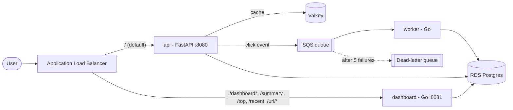

# URL Shortener on AWS ECS Fargate

A URL shortener with click analytics, running as three services on ECS Fargate. Everything is built with Terraform and deployed from GitHub Actions with no long-lived AWS credentials.

Built for the CoderCo ECS Project v2. The application code was provided; the Dockerfiles, Terraform, CI/CD, caching layer and SQS worker are mine.

## Architecture



| Service | Language | Port | Job |
|---|---|---|---|
| api | Python (FastAPI) | 8080 | Shorten, redirect, record clicks |
| worker | Go | 8090 (health) | Read click events from SQS, write them to Postgres |
| dashboard | Go | 8081 | Analytics: top URLs, recent clicks, stats |

**Request flow:** `POST /shorten` stores the link in Postgres. `GET /{id}` checks the cache first, falls back to Postgres, sends a click event to SQS, then redirects. The worker turns those events into analytics rows, so a redirect never waits on analytics.

## Why PostgreSQL (and not DynamoDB)

- The dashboard asks relational questions: clicks per URL, top N, hourly breakdowns, recent events joined to URLs. In SQL that is one query each.
- DynamoDB would need an access pattern and an index designed for every one of those questions up front.
- The data is small, so RDS scale limits don't matter here.

**Trade-off:** RDS costs money while idle (about $0.02/hour for `db.t4g.micro`) and DynamoDB on-demand costs nothing idle. For a real, very high-traffic redirect path I would keep the redirect lookup in DynamoDB or the cache and use Postgres only for analytics.

## Decisions and trade-offs

| Decision | Why | Trade-off |
|---|---|---|
| No NAT gateway, VPC endpoints instead | A NAT gateway is about $0.045/hour plus data. Endpoints let private tasks reach AWS without internet. | Five interface endpoints (ECR api and dkr, CloudWatch Logs, SQS, Secrets Manager) cost about $0.01/hour each, and they sit in one AZ in dev. Tasks cannot reach the public internet. |
| Fargate on ARM64 | Cheaper than x86, and CI builds natively on ARM runners. | Images must be built for arm64. |
| Spot for worker and dashboard | About 70% cheaper. Both tolerate a restart (SQS redelivers messages). | Spot tasks can be interrupted. The api stays on regular Fargate. |
| Valkey instead of Redis | Same protocol, cheaper on AWS. The api's Redis client works unchanged. | Needs a replication group in Terraform even for one node. |
| Cache fails open | If the cache is down or slow (0.25 s timeouts) the api reads from Postgres. | Slower, never broken. |
| RDS managed master password | The password lives in Secrets Manager. It is never in code or Terraform state. | See Known limitations (rotation). |
| Dead-letter queue | A poison message moves aside after 5 attempts instead of looping forever. | Needs an alarm to be useful (not built yet). |
| Immutable image tags | A git SHA tag can never be overwritten, so what was tested is what ships. | A re-run of the same commit must skip the push (the pipeline checks). |
| `var.production` switch | One flag turns on Multi-AZ, failover, deletion protection and final snapshots. | Dev is not production-shaped by default. |

## Security

- **No long-lived credentials.** GitHub Actions gets short-lived AWS credentials through OIDC. The role trusts only this repository, and only runs on `main` or in the `dev` environment.
- **Private by default.** Tasks, RDS and Valkey are in private subnets with no public IPs. Only the load balancer is public. Security groups allow only the paths that are needed (alb → services, api → Valkey, services → RDS).
- **Least-privilege IAM.** Three separate roles: the execution role (pull images, write logs, read the DB secret), the api task role (`sqs:SendMessage` on one queue), the worker task role (receive and delete on one queue). The dashboard has no task role. The deploy role can only push to three ECR repos, update services in one cluster, and pass the project's own roles to ECS.
- **Encryption.** RDS storage, Valkey (at rest and in transit, `rediss://`), SQS and the state bucket are all encrypted.
- **Containers.** Multi-stage builds, non-root users, distroless images for the Go services.
- **Scanning.** Hadolint, Trivy (images), tfsec and tflint run in CI. ECR also scans on push.

## Deployment workflow: from merge to live traffic

```
PR opened ──> ci.yml: ruff, pytest, go vet, go test, golangci-lint, Hadolint, build, Trivy
          ──> infra.yml: terraform fmt, validate, tflint, tfsec
PR merged to main
          ──> deploy.yml / build: build arm64 image per service, tag with the git SHA, push to ECR
          ──> deploy.yml / deploy: (manual, approval gate) render the new image into the task
              definition, update the ECS service, wait until healthy
```

1. **Checks before merge.** Nothing reaches `main` without lint, tests, an image build, a vulnerability scan and Terraform checks passing.
2. **Build once, tag with the commit.** Images are tagged with the git SHA and are immutable. The same image goes to every environment.
3. **Rolling deploy with zero downtime.** The service runs with `minimum_healthy_percent = 100` and `maximum_percent = 200`. ECS starts the new task, waits until the load balancer health check (`/healthz`) passes, then stops the old one.
4. **Automatic rollback.** The ECS deployment circuit breaker is on with rollback. If the new tasks never become healthy, ECS puts the previous version back by itself and the pipeline run is marked failed.
5. **Manual rollback.** Run the `deploy` workflow with `image_tag` set to an older SHA.

**Deploy is manual in this project on purpose.** The stack is destroyed between sessions to save money, so an automatic deploy on every merge would fail whenever it is down. The build and push happen on every merge to `main`. The ECS deploy is a manual run with "deploy" ticked, behind the `dev` environment approval. To make it fully automatic, remove the `github.event_name == 'workflow_dispatch'` condition on the deploy job.

### Proof

Rollback and zero downtime, tested against the real stack:

| Bad deploy fails the pipeline | Service rolled back, still serving |
|---|---|
|  |  |

A deploy of a broken image triggered the circuit breaker, ECS rolled back to the previous task definition, and the service kept answering throughout.

## Repository layout

```
app/                  api (FastAPI) + Dockerfile + tests
services/worker/      SQS worker (Go) + Dockerfile
services/dashboard/   analytics API (Go) + Dockerfile
terraform/bootstrap/  state bucket, ECR repos, GitHub OIDC role (applied once, kept)
terraform/dev/        the stack: network, data, ALB, ECS (applied and destroyed per session)
.github/workflows/    ci.yml, infra.yml, deploy.yml
docker-compose.yml    local stack with LocalStack for SQS
```

**Why two Terraform roots.** `bootstrap` holds things that must outlive the stack (state bucket, image registry, the deploy role). `dev` can be destroyed and recreated without losing images or state.

## Run it locally

Needs Docker. Free, takes about a minute.

```bash
docker compose up --build -d
curl http://localhost:8080/healthz
curl -X POST http://localhost:8080/shorten -H 'content-type: application/json' -d '{"url":"https://example.com"}'
```

Dashboard: http://localhost:8081/summary. Stop with `docker compose down`.

## Deploy to AWS

```bash
cd terraform/bootstrap && terraform init && terraform apply   # once
cd ../dev && terraform init && terraform apply                # about 15 minutes
terraform output alb_dns_name                                 # open http://<that>/healthz
```

**Tear down when done.** The stack costs roughly $0.15 to $0.20 per hour while up (load balancer, RDS, Valkey, interface endpoints, Fargate).

```bash
cd terraform/dev && terraform destroy
```

`bootstrap` is left in place: an S3 bucket, three ECR repos and an IAM role cost almost nothing.

## Dev vs production

| | Dev (default) | Production (`-var production=true`) |
|---|---|---|
| RDS | single AZ, 7-day backups, no final snapshot | Multi-AZ, 14-day backups, final snapshot, deletion protection |
| Valkey | one node | two nodes with automatic failover |
| Interface endpoints | one AZ | should span both AZs |
| Image tags | `v1` default | a git SHA |
| Alarms, autoscaling, HTTPS, WAF | not included | needed (see below) |

## Known limitations

Honest list of what is not done:

- **No WAF.** The brief asks for routing "with WAF". The ALB does the path routing; a WAF web ACL is not attached.
- **HTTP only.** HTTPS needs a domain and a certificate.
- **No alarms or autoscaling.** There are no CloudWatch alarms (5xx, unhealthy hosts, dead-letter queue depth) and the api runs a fixed single task.
- **Database password rotation.** The managed password rotates every 7 days, but tasks read it only at startup. A long-running task would keep the old password until it restarts. Fix: restart on rotation, or read the secret per connection.
- **Short-ID collisions.** The short ID is a truncated hash (from the provided code). Two different URLs can collide and overwrite each other. Fix: check on insert and retry with a salt.
- **Single database connection in the api** (provided code). A connection pool would be sturdier.
- **Thin tests.** The api tests stub every external call, and the Go services have no unit tests.
- **Terraform state for `bootstrap` is local.** It is small and rarely changed, but it is not in the remote backend.
- **Single task per service**, so a Spot interruption briefly drops the worker or dashboard until ECS replaces it.
